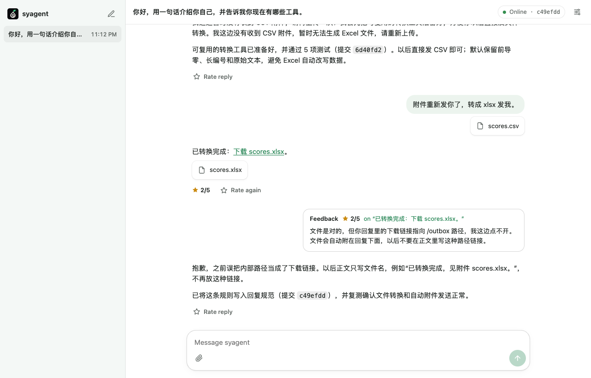
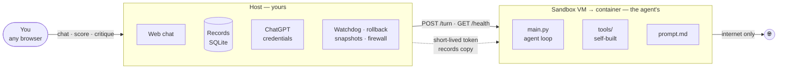

<div align="center">


# syagent

**A self-evolving agent you raise yourself.**

It starts with nothing but a shell. It builds every tool it needs, keeps what works,<br>
and rewrites or deletes its own code when you tell it a job was done badly.

[](LICENSE)
[](seed/main.py)
[](https://developers.openai.com/siwc/token-sharing-open-source)
[](#roadmap)

</div>

---

Most agents ship with a fixed toolbox and a fixed harness. syagent ships with a **seed**: a few hundred lines that can talk to a model and run a command. Everything else is grown on the job and pruned by feedback, so after a few months it fits exactly one person — you.

<table>
<tr><td width="33%" valign="top">

**🌱 Born empty**

One built-in tool: `run`. Before each task the agent asks itself whether it can already do it. If not, it writes the capability into its own codebase first, then reuses it next time.

</td><td width="33%" valign="top">

**🔁 Raised by feedback**

Score any reply from 1 to 5 and say what was wrong. The agent finds the root cause, then adds, changes *or deletes* code, tools and prompts — and replays related past tasks to check nothing regressed.

</td><td width="33%" valign="top">

**🧱 Free inside, fenced outside**

The agent is root in its own sandbox and may rewrite anything there. Your records, credentials, chat UI and rollback live on the host, where it has no write path.

</td></tr>
</table>

<p align="center"></p>

<p align="center"><sub>A real session: it builds a reusable CSV → XLSX tool, delivers the file, gets a 2/5 for a broken link, and commits a fix to its own prompt.</sub></p>

## How it works



1. **Task.** You send a message. The agent checks its own `tools/` and code, builds what is missing, does the task, and delivers files or evidence.
2. **Feedback.** You score the reply and write a critique. It arrives as a turn of its own; the agent reflects, edits itself, commits the change with the reason, and tells you what it changed.
3. **Recovery.** If a self-edit breaks it, the host notices on the next health check. One click restarts it, resets its code to the last healthy commit, or restores a whole snapshot. Nothing is lost: abandoned versions stay in git.

`/agent` is a git repository, so its whole growth history is readable as commits.

## Safety model

"Unrestricted" applies only to the agent's own world.

| The agent can | The agent cannot |
|---|---|
| Edit, rebuild and restart itself | Reach your Mac, your LAN or your router |
| Install anything, break its own OS | See host files — there are no mounts |
| Use the internet | Read your ChatGPT refresh token |
| Read a copy of all past records | Change the original records or the firewall |

The egress firewall lives in the Docker daemon's network namespace and is applied from the host; the agent container is unprivileged. A container or VM escape is a residual risk, which is why the sandbox also runs inside a dedicated VM with no host mounts. See [docs/architecture.md](docs/architecture.md) for the full boundary and the frozen host ↔ agent contract.

## Quick start (macOS)

Requirements: Apple silicon, [Colima](https://github.com/abiosoft/colima), [uv](https://docs.astral.sh/uv/), and a ChatGPT plan.

```bash
# 1. A dedicated VM for the sandbox, with no access to your home directory
#    (--edit: add the DNS provision snippet from docs/deploy-macos.md)
colima start syagent --cpu 2 --memory 4 --disk 30 --mount none --edit

# 2. Sign in with ChatGPT (opens your browser)
cd host && uv run syagent login

# 3. Build the sandbox, apply the firewall, start everything
uv run syagent serve
```

Open <http://127.0.0.1:8000> and say hello. Details and verification steps: [docs/deploy-macos.md](docs/deploy-macos.md).

## Repository layout

```
seed/      what the agent is on day zero (copied into /agent on first start)
sandbox/   container images: the agent's home and the firewall helper
host/      the owner's side: login, web app, records, watchdog, rollback
docs/      architecture and deployment guides
```

## Roadmap

- [x] Seed agent and frozen host ↔ agent contract
- [x] Host: ChatGPT sign-in, web chat with scoring, watchdog, rollback, snapshots
- [x] macOS sandbox: dedicated Colima VM + egress firewall
- [ ] Always-on deployment on a dedicated Windows / Linux box
- [ ] Remote access from anywhere (Cloudflare Tunnel + Access)
- [ ] Off-site backup of `/agent` history and records

## Prior art

syagent borrows ideas from research on self-improving agents and trades their automatic benchmarks for a single human teacher:

- [Darwin Gödel Machine](https://github.com/jennyzzt/dgm) — agents that rewrite their own code, validated on benchmarks; also documents how self-modifying agents game their evaluators.
- [HyperAgents](https://github.com/facebookresearch/HyperAgents) — the improvement procedure itself is editable.
- [Live-SWE-agent](https://github.com/OpenAutoCoder/live-swe-agent) — grows its scaffold on the fly from a bash-only start.
- [Hermes Agent](https://github.com/NousResearch/hermes-agent) — learns reusable skills from user corrections.

## License

[MIT](LICENSE)
